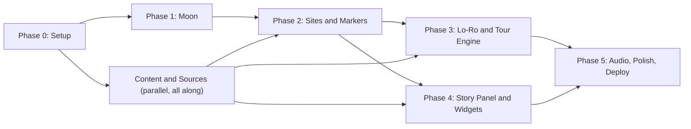

# Coding Plan — Abandoned, Not Forgotten

This folder turns [PROJECT_OVERVIEW.md](../../PROJECT_OVERVIEW.md) into an actionable build plan.
Each phase file lists **goals, tasks (with file paths), key code contracts, acceptance criteria, and risks**.

## Documents

| # | File | What it covers |
| :-- | :-- | :-- |
| 0 | [00-setup-and-conventions.md](00-setup-and-conventions.md) | Scaffolding, dependencies, folder layout, coordinate conventions, coding rules |
| 1 | [01-moon-rendering.md](01-moon-rendering.md) | NASA texture pipeline, tiled progressive Moon, lighting, starfield, camera rig |
| 2 | [02-site-data-and-markers.md](02-site-data-and-markers.md) | Data schema, hero/secondary site seed list, markers, picking, filters, site index |
| 3 | [03-loro-and-tour-engine.md](03-loro-and-tour-engine.md) | App store, Lo-Ro character, dialogue system, intro, guided tour engine, explore mode |
| 4 | [04-story-panel-and-interactions.md](04-story-panel-and-interactions.md) | Site story drawer, Then vs. Now slider, 3D hardware spotlight, 3 science widgets |
| 5 | [05-audio-polish-credits-deploy.md](05-audio-polish-credits-deploy.md) | Audio engine, narration, accessibility, performance, credits drawer, deploy, QA |
| 6 | [06-content-and-sources.md](06-content-and-sources.md) | Writing guide, script templates, fact ledger, asset acquisition checklist, licensing |

## Priority Legend

Every task is tagged:

- **P0** — MVP. Required for a working, judge-ready demo.
- **P1** — Strongly recommended. Adds the "wow" and the storytelling depth.
- **P2** — Stretch. Only after P0 + P1 are solid.

## Build Order & Dependencies

Phases 3 and 4 can run **in parallel** once the site data contract (Phase 2) is merged.
Content writing (doc 6) starts on day one and runs alongside everything.

## The 48-Hour Cut Line (Space Apps is a 48h hackathon)

If time is short, ship exactly this and nothing else:

1. Moon at the 4K tier with normal map + sun lighting + starfield (Phase 1, P0).
2. All 9 hero sites + ≥ 12 secondary sites as clickable markers (Phase 2, P0).
3. Lo-Ro SVG with 3 moods, captions, Web Speech voice, intro + 5-chapter tour (Phase 3, P0).
4. Story drawer with memory log, stats, Then vs. Now slider, and the **Laser Retroreflector** widget (Phase 4, P0).
5. NASA Data Sources drawer + deployed URL + demo video (Phase 5, P0).

Everything tagged P1/P2 is upside.

## Suggested Team Split (4 people)

| Role | Owns |
| :-- | :-- |
| **3D / Graphics** | Phase 1, markers in Phase 2, model viewer in Phase 4 |
| **App / UI** | Phase 0, store + tour engine (Phase 3), story drawer (Phase 4), deploy |
| **Story / Research** | Doc 6: scripts, fact ledger, coordinates verification, image/model sourcing |
| **Design / Audio** | Lo-Ro SVG art + animation, UI look, audio engine + narration (Phase 5) |

## Definition of Done (whole project)

- [ ] Loads to an interactive Moon in < 3 s on a typical laptop over broadband.
- [ ] Holds ~60 FPS on a mid-range laptop at the default quality tier; never drops below 30 FPS.
- [ ] Guided tour plays start-to-finish without errors, with captions, with or without audio.
- [ ] Every number shown to users traces to an entry in `src/data/sources.ts`.
- [ ] Works with keyboard only; respects `prefers-reduced-motion`.
- [ ] Deployed to a public URL; README explains how to run and lists NASA data used.
